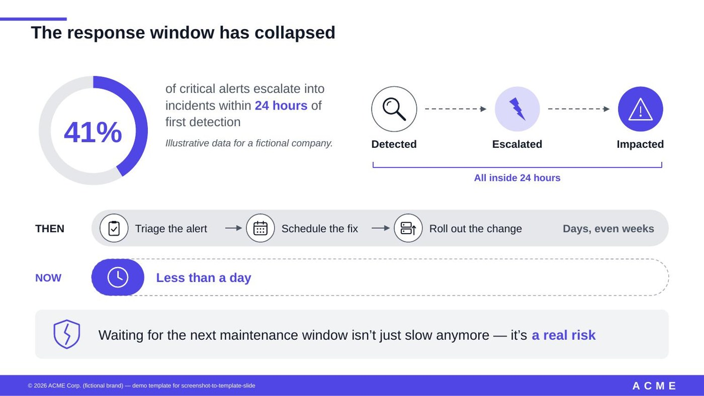
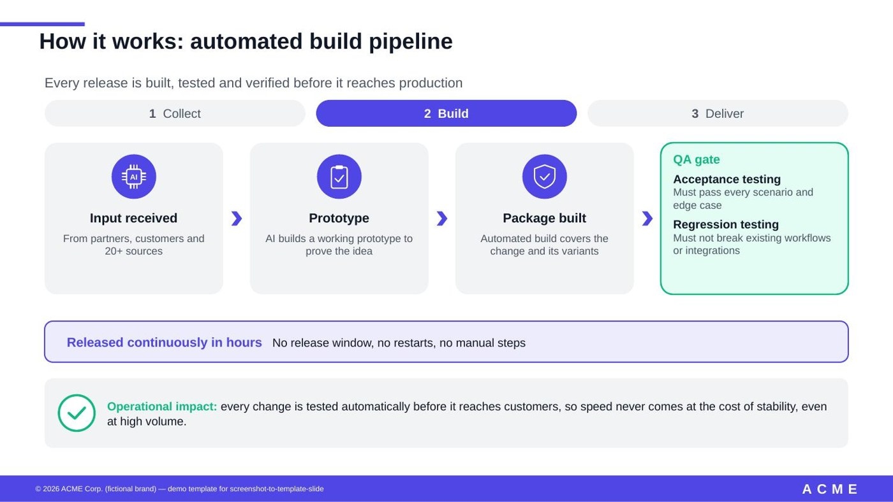
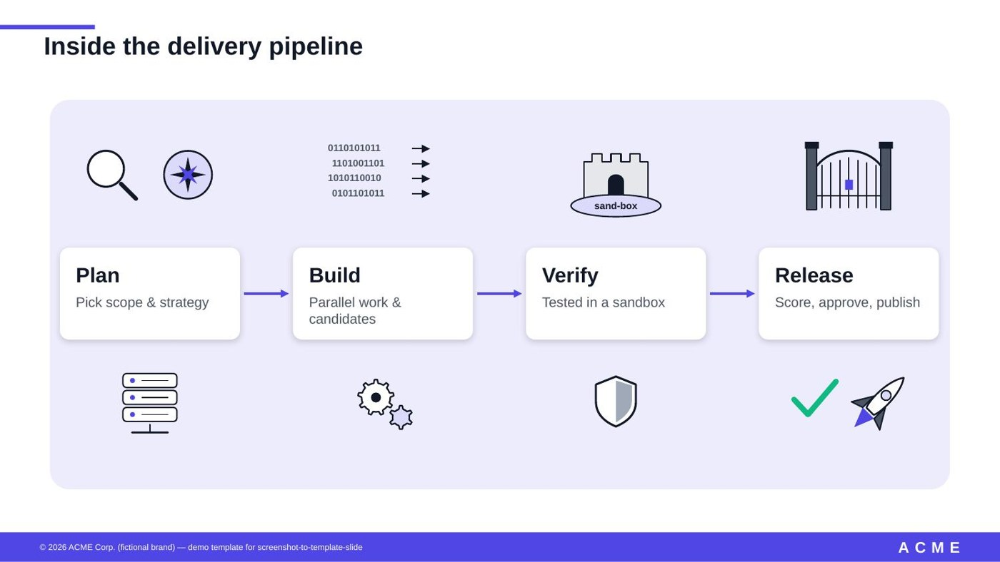
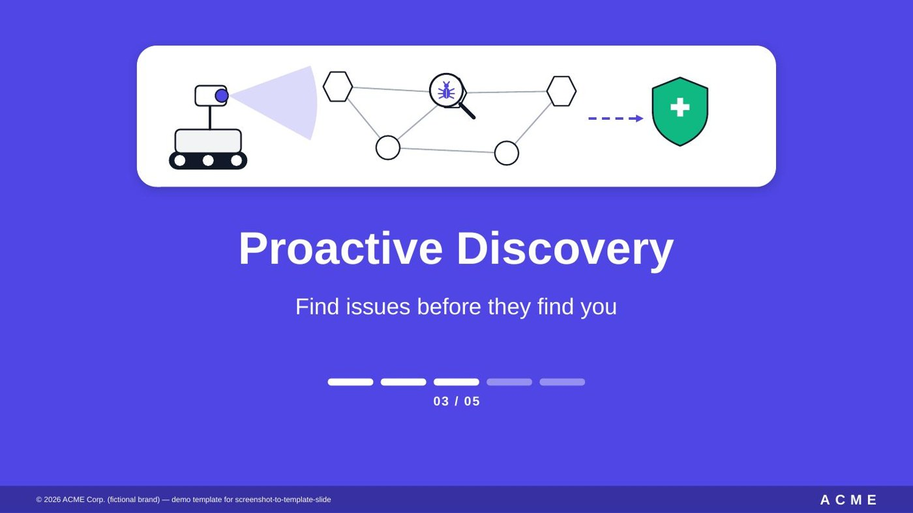

# screenshot-to-template-slide

把 **幻灯片截图（原图）+ 讲稿 + 可选参考 slide**，在你指定的 **PPTX 模版**上重建成一页**可编辑、图文并茂**的幻灯片。生成的页面全部用原生形状（不是图片），配色用模版的主题色，模版里的任何文件都不改。

这是一个 [Claude](https://claude.ai) Agent Skill。规则和工具来自一次真实的多轮协作：用二十多页 explainer 迭代出来，用户纠正过的每一处都写进了硬规则。

## 效果示例
下面几张都是本 skill 在虚构品牌 **ACME** 的演示模版（`examples/demo-template.pptx`）上生成的**可编辑 PPTX**，全部用原生形状绘制，配色取自模版的主题色。图中数据都是演示用的虚构数据。



| How it works 标签页 | 插画型流程页 | 章节分隔页 |
|---|---|---|
|  |  |  |

对应的源码在 `examples/stat_timeline.py`、`how_it_works_tabs.py`、`illustrated_flow.py`、`section_divider.py`。换一个模版重新构建，配色和字体会自动跟着模版走。

## 特点
- **规则先行**：原图文字逐字保留，讲稿不上页面（可以写进演讲者备注），版式结构照原图，模版保持原样，每页只出一个方向，同级元素样式统一。
- **slidekit**：原生 OOXML 形状库，包括 26 种图标、20 多个插画部件，以及标签条、进度条、阴影卡片、荧光高亮等页面辅助函数。
- **一条命令完成构建和 QA**：注入形状 → 统一字体（自动检测模版标题字体）→ 用 validate 校验 → 和模版逐文件比对 → 字号放大 6% 做压力渲染 → 导出页面文字供核对。
- **整套 deck 合并**：按版式名称对应，合并多个单页文件。
- **中文模式**：`--lang zh`，中文字体单独设置，术语保留英文。

## 安装
- **Claude 桌面版 / Cowork**：到 [Releases](https://github.com/puww1010/screenshot-to-template-slide/releases/latest) 下载 `screenshot-to-template-slide.skill`，在对话里打开后点 **Save skill**。
- **Claude Code**：把仓库复制到 `~/.claude/skills/screenshot-to-template-slide/`。

依赖：Python 3、`zip`；QA 渲染需要 LibreOffice 和 `pdftoppm`；`markitdown` 可选（没有时脚本自己提取页面文字）。Anthropic 官方 `pptx` skill 是**可选**的：装了就用它的 validate、soffice、clean，没装就走内置兜底流程。

## 在其他 AI Agent 中使用
本 skill 遵循 Agent Skills 的目录约定：一个文件夹，里面有带 `name`/`description` 头信息的 `SKILL.md`，再配上 `scripts/`、`references/` 和 `examples/`。

| 环境 | 用法 |
|---|---|
| Claude 桌面版 / Cowork | 从 Releases 下载 `.skill`，点 **Save skill** |
| Claude Code | 复制到 `~/.claude/skills/screenshot-to-template-slide/` |
| 支持 Agent Skills 格式的其他 agent | 把整个文件夹放进该工具约定的 skills 目录（具体位置以对方文档为准） |
| 不支持 skills 的 agent | 把 `SKILL.md` 正文当作系统提示词或项目说明（例如 `AGENTS.md`），并把 `scripts/` 放到它能执行的位置 |

前提是 agent 要能**执行 shell 和 Python**，并且能**查看图片**（用来检查 QA 渲染图）。只能聊天的模型可以照着规则操作，但跑不了自动构建和检查。SKILL.md 里出现的 AskUserQuestion、`computer://` 等是 Claude 的工具名，在其他环境里请换成对应的能力，文中都已注明。

## English summary
Rebuild a slide **screenshot + speaker script** into an **editable, template-faithful PPTX slide** with native shapes (no images), theme colours and zero template modification. Ships `slidekit` (26 icons, 20+ illustration parts), a one-command build/QA pipeline (font unification, package validation, template diff, +6% stress render, text audit), a deck merger, speaker-notes injection and a Chinese mode. Works with any agent that can run shell + Python; Anthropic's `pptx` skill is optional.

## 快速开始
没有现成的模版也可以先用演示模版试跑：
```bash
python3 scripts/build_slide.py --template examples/demo-template.pptx --page examples/stat_timeline.py --out demo.pptx --qa-dir qa/
python3 scripts/build_slide.py --template examples/demo-template.pptx --page examples/section_divider.py --out divider.pptx --layout "ACME Section Divider"
```
换成你自己的模版：
```bash
python3 scripts/list_layouts.py MyTemplate.pptx --grep Section
python3 scripts/build_slide.py --template MyTemplate.pptx --page examples/how_it_works_tabs.py \
        --out out.pptx --qa-dir qa/ [--layout "Section Divider"] [--notes script.txt] [--lang zh]
python3 scripts/merge_deck.py --out deck.pptx cover.pptx agenda.pptx ch1.pptx ...
```
`page.py` 只需定义 `build()`，返回 slidekit 形状列表，写法参考 `examples/`。

## 目录
```
SKILL.md                      规则与工作流（给 Claude 读）
scripts/slidekit.py           原生形状与图标库
scripts/build_slide.py        单页构建与 QA
scripts/merge_deck.py         合并整套 deck
scripts/list_layouts.py       列出模版版式
examples/                     4 个示例页 + 演示模版 demo-template.pptx（虚构品牌 ACME）+ 输入输出对照 illustrated_flow_io.md
docs/images/                  README 里的效果示例图
references/                   页型结构、QA 清单、常用说法对照、模版预设示例、测试清单 testing.md
tests/test_regressions.py     回归测试（行距单位、lint、中文标注、画布尺寸、字体提示）
```

## License
[MIT](LICENSE)
